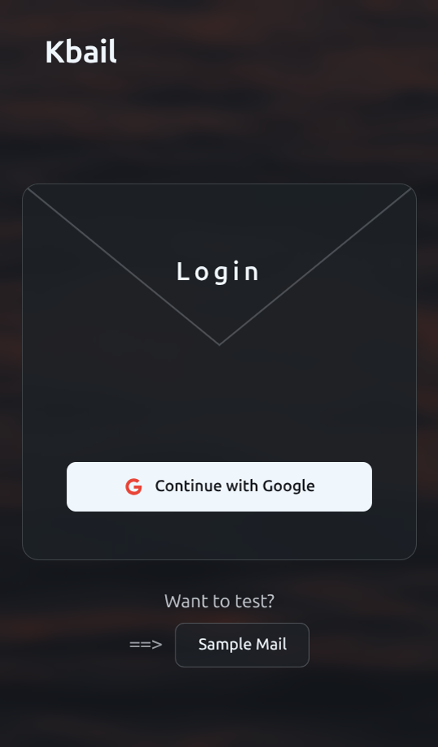
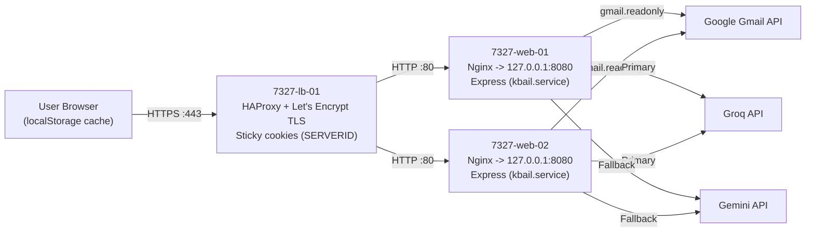
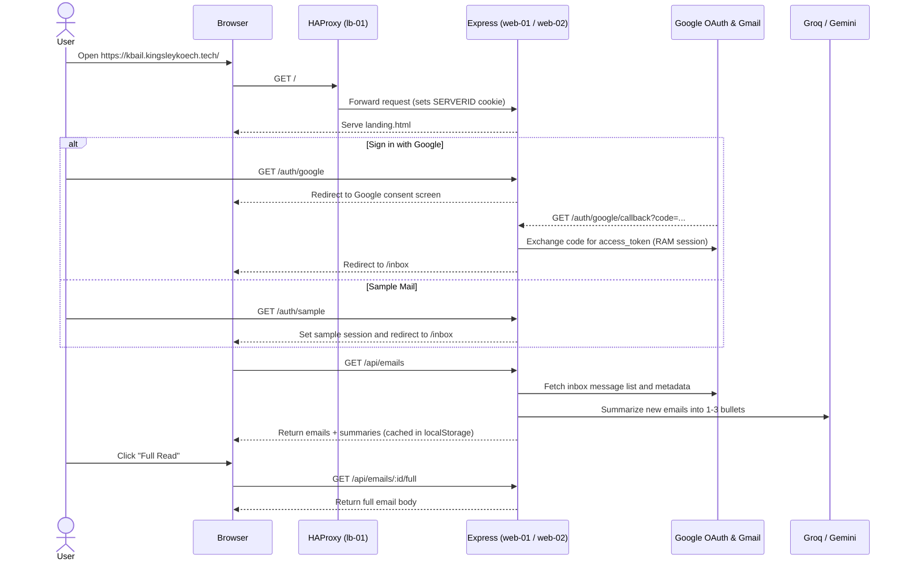

# K-Bail-

K-Bail- (Kingsley Brief Mail) is a privacy-first Gmail reader that turns long emails into 1–3 bullet summaries, with a full-read view one click away.

**Live app:** [kbail.kingsleykoech.tech](https://kbail.kingsleykoech.tech)

> [!TIP]
> Want to try the app without signing into a Google account? Click **Sample Mail** on the landing page to load the demo inbox immediately.

---

## Product preview

<table>
  <tr>
    <td width="34%" valign="top">
      <strong>Landing &amp; Login (<code>/</code>)</strong><br />
      Envelope login card with Google OAuth and Sample Mail demo mode.<br /><br />
      
    </td>
    <td width="66%" valign="top">
      <strong>3-Pane Workspace (<code>/inbox</code>)</strong><br />
      Searchable inbox on the left, 1–3 bullet AI summary in the center, and on-demand full message on the right.<br /><br />
      
    </td>
  </tr>
</table>

---

## Why it is built this way

Long threads, newsletters, and automated alerts hide the two sentences that actually matter. Instead of storing your mailbox in a cloud database, K-Bail- reads messages on demand over read-only OAuth, summarizes only the newest/unread items, and keeps cached mail strictly inside your browser.

---

## System architecture



### Request & OAuth flow



---

## Google Sign-In note (Unverified App screen)

> [!IMPORTANT]
> Because K-Bail- requests the `gmail.readonly` scope without undergoing Google's commercial OAuth verification review, Google displays a **"Google hasn't verified this app"** screen during sign-in:
>
> 1. Click **Advanced** at the bottom-left of the warning card.
> 2. Click **Go to kbail.kingsleykoech.tech (unsafe)**.
> 3. Grant the read-only permissions (`gmail.readonly` and `userinfo.email`) to open `/inbox`.

---

## Interface & controls

The `/inbox` workspace is organized into three columns over a translucent glass layout:

1. **Inbox** — Lists synced emails with live search, `All` / `Today` filtering, and sorting (`Newest`, `Oldest`, `Sender`).
2. **Summarize** — Shows the 1–3 bullet AI summary for the selected email, generated with Groq first and falling back to Gemini if Groq is unavailable or rate-limited.
3. **Full Mail** — Fetches the complete email body on demand via `GET /api/emails/:id/full` when you click **Full Read**.

Top bar controls:
- **SYNC mail** triggers `POST /api/sync` to fetch new messages and summarize them.
- **Settings** opens the profile modal showing the active account (or `Sample Mailbox`) and a **Logout** button (`/auth/logout`).

---

## Privacy & security model

| Layer | Stored data | Lifecycle |
| :--- | :--- | :--- |
| **Browser (`localStorage`)** | Synced email metadata and AI bullet summaries | Stays on your device; cleared on logout/reset |
| **Server RAM (`express-session`)** | `mode`, `userEmail`, short-lived Google `accessToken` | Held in memory only; destroyed on `/auth/logout` |
| **Server disk / database** | Nothing | No database and no persisted user emails |

Key safeguards:
- **Minimal OAuth scopes:** Only `gmail.readonly` and `userinfo.email`.
- **Clean, gated routes:** `/` serves the login page, `/inbox` redirects unauthenticated visitors to `/`, and raw HTML files under `UIUX/html/` are not served statically.
- **HTTPS everywhere:** `7327-lb-01` redirects `:80` to `:443` using a Let's Encrypt certificate for `kbail.kingsleykoech.tech`.
- **Sticky sessions:** HAProxy pins each browser session to `web01` or `web02` via `SERVERID` cookies so in-memory Express sessions stay consistent.

---

## Local setup

### Prerequisites
- Node.js 20+ and npm
- A Google Cloud project with the **Gmail API** enabled and an **OAuth 2.0 Web Client**
- A **Groq** API key (and optionally a **Gemini** API key for fallback)

### 1. Clone and install

```bash
git clone https://github.com/kingsleykipkoech/K-Bail-.git
cd K-Bail-/BACKENDS
npm install
```

### 2. Configure `BACKENDS/.env`

Create `BACKENDS/.env` (gitignored):

```env
PORT=8080
HOST=127.0.0.1
SESSION_SECRET=replace-with-a-random-secret

GOOGLE_CLIENT_ID=your-google-client-id
GOOGLE_CLIENT_SECRET=your-google-client-secret
GOOGLE_REDIRECT_URI=http://localhost:8080/auth/google/callback

GROQ_API_KEY=your-groq-api-key
GEMINI_API_KEY=your-gemini-api-key

GMAIL_MAX_RESULTS=100
MAX_SUMMARIZE_PER_SYNC=5
```

| Variable | Purpose | Default |
| :--- | :--- | :--- |
| `PORT` | Port Express listens on | `8080` |
| `HOST` | Bind address | `127.0.0.1` |
| `SESSION_SECRET` | Secret used to sign session cookies | `kbail-dev-secret` |
| `GOOGLE_CLIENT_ID` | Google OAuth client ID | Required for Google login |
| `GOOGLE_CLIENT_SECRET` | Google OAuth client secret | Required for Google login |
| `GOOGLE_REDIRECT_URI` | Callback URL registered in Google Cloud | Required for Google login |
| `GROQ_API_KEY` | Primary AI summarizer API key | Required for live AI summaries |
| `GEMINI_API_KEY` | Fallback AI summarizer API key | Optional |
| `GMAIL_MAX_RESULTS` | Maximum messages fetched per sync | `100` |
| `MAX_SUMMARIZE_PER_SYNC` | Maximum messages summarized per sync | `5` |

### 3. Start the server

```bash
npm start
```

Open `http://localhost:8080`.

---

## API & route reference

| Method | Route | Auth | Description |
| :--- | :--- | :--- | :--- |
| `GET` | `/` | Public | Serves `landing.html` |
| `GET` | `/inbox` | Session | Serves `home_page.html` or redirects to `/` if not signed in |
| `GET` | `/auth/google` | Public | Redirects to Google OAuth 2.0 consent screen |
| `GET` | `/auth/google/callback` | Public | Exchanges authorization code for token and redirects to `/inbox` |
| `GET` | `/auth/sample` | Public | Starts a demo session using `sample_emails.json` and redirects to `/inbox` |
| `GET` | `/auth/logout` | Session | Destroys Express session, clears cookie, redirects to `/` |
| `GET` | `/api/health` | Public | Returns `{"status":"ok","storage":"browser-local"}` |
| `GET` | `/api/me` | Required | Returns `{ mode, email }` for the active session |
| `GET` | `/api/emails` | Required | Fetches emails and generates bullet summaries |
| `POST` | `/api/sync` | Required | Refreshes inbox and summarizes new emails |
| `GET` | `/api/emails/:id/full` | Required | Returns the full body of a single email |

---

## Project structure

```text
K-Bail-/
├── assets/
│   ├── clouds.mp4               # Background video used on landing and inbox views
│   ├── landing-preview.png      # Landing page screenshot
│   └── inbox-preview.png        # 3-pane inbox screenshot
├── BACKENDS/
│   ├── package.json             # Express, express-session, dotenv
│   ├── sample_emails.json       # Sample mailbox dataset for demo mode
│   └── server.js                # Express app, OAuth, Gmail API, Groq/Gemini summarizer
└── UIUX/
    ├── html/
    │   ├── landing.html         # Login view (served at /)
    │   └── home_page.html       # 3-pane inbox view (served at /inbox)
    ├── scripts/
    │   └── home_page.js         # Inbox state, search/filter/sort, localStorage caching
    └── styles/
        ├── base.css             # Shared reset, typography, glass layers, background video
        ├── landing.css          # Envelope login card and Sample Mail callout
        └── home_page.css        # 3-column layout, summary/full-mail panes, profile modal
```

---

## Production deployment

| Server | Role | Configuration |
| :--- | :--- | :--- |
| **`7327-lb-01`** | Load balancer & TLS termination | HAProxy terminating HTTPS (`:443`) with Let's Encrypt certificate for `kbail.kingsleykoech.tech`, 301 redirect from `:80`, and `SERVERID` sticky session cookies |
| **`7327-web-01`** | Application node 1 | Nginx reverse proxy (`kbail.kingsleykoech.tech` -> `127.0.0.1:8080`) + Node.js 20 managed by `systemd` (`kbail.service`) |
| **`7327-web-02`** | Application node 2 | Nginx reverse proxy (`kbail.kingsleykoech.tech` -> `127.0.0.1:8080`) + Node.js 20 managed by `systemd` (`kbail.service`) |

Both web nodes share the same `SESSION_SECRET` and use `GOOGLE_REDIRECT_URI=https://kbail.kingsleykoech.tech/auth/google/callback` in `BACKENDS/.env`.

---

## Author

Built by **Kingsley Kipkoech** (`k.kipkoech@alustudent.com`)
