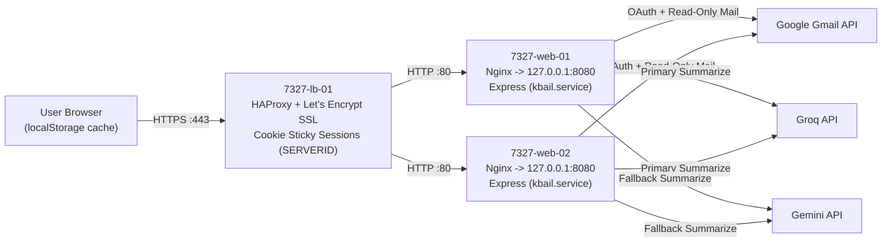
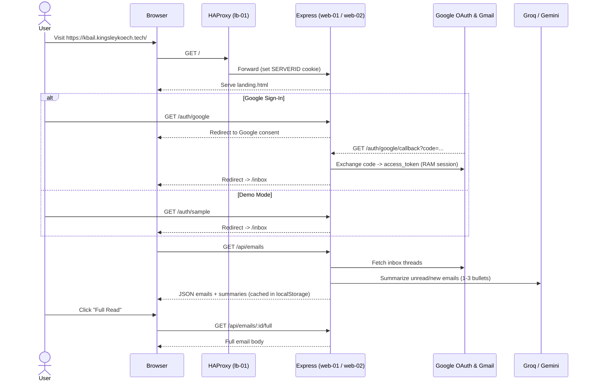

<div align="center">

# Kbail — Kingsley Brief Mail

**Privacy-first Gmail inbox & AI email summarizer — zero server database, instant bullet briefs, and full-read fallback.**

[](https://kbail.kingsleykoech.tech)
[](https://nodejs.org/)
[](https://expressjs.com/)
[](https://www.haproxy.org/)
[](https://nginx.org/)

[Open Live App](https://kbail.kingsleykoech.tech) | [Try Sample Mailbox](https://kbail.kingsleykoech.tech/auth/sample) | [API Reference](#api-endpoints)

</div>

---

## Key Features

| Feature | What It Does |
| :--- | :--- |
| **Google OAuth 2.0** | Read-only Gmail access (`gmail.readonly`, `userinfo.email`) with Google-hosted sign-in |
| **Sample Mailbox Mode** | One-click demo mode (`Sample Mail`) with preloaded emails — no Google login required |
| **AI Bullet Summaries** | Distills emails into **1–3 bullet briefs** using **Groq** (`Llama`) with automatic **Gemini** fallback |
| **3-Pane Glass UI** | **Inbox** (search, `All`/`Today` filter, sort) / **Summarize** (AI brief) / **Full Mail** (on-demand full body) |
| **Zero Server Database** | Emails & summaries are never persisted on the server — cached in browser `localStorage` only |
| **High-Availability Stack** | Load-balanced across `web-01` & `web-02` behind `lb-01` with Let's Encrypt HTTPS & sticky sessions |

---

## Production Architecture



---

## Request & Auth Flow



---

## Privacy-First Storage Model

| Layer | Stored Data | Persistence |
| :--- | :--- | :--- |
| **Browser (`localStorage`)** | Fetched email metadata & AI bullet summaries | Client-side only (cleared on logout/clear) |
| **Server RAM (`express-session`)** | `mode`, `userEmail`, short-lived `accessToken` | Ephemeral in-memory; destroyed on `/auth/logout` |
| **Server Disk / Database** | **None** | Zero database, zero email files written to disk |

---

## Repository Structure

```text
K-Bail-/
├── assets/
│   └── clouds.mp4               # Ambient looping sky video background
├── BACKENDS/
│   ├── package.json             # Express & dotenv dependencies
│   ├── sample_emails.json       # Demo mailbox dataset
│   └── server.js                # Express app, OAuth, Gmail sync, Groq/Gemini summarizer
└── UIUX/
    ├── html/
    │   ├── landing.html         # Served cleanly at /
    │   └── home_page.html       # Served cleanly at /inbox (auth-gated)
    ├── scripts/
    │   └── home_page.js         # 3-pane UI logic, search/filter/sort, localStorage cache
    └── styles/
        ├── base.css             # Shared typography, glass layers, background video
        ├── landing.css          # Envelope login card & sample callout
        └── home_page.css        # 3-column inbox, summary, full mail & profile modal
```

---

## API Endpoints

| Method | Route | Auth | Purpose |
| :--- | :--- | :---: | :--- |
| `GET` | `/` | Public | Serves `landing.html` |
| `GET` | `/inbox` | Session | Serves `home_page.html` (redirects to `/` if unauthenticated) |
| `GET` | `/auth/google` | Public | Starts Google OAuth 2.0 flow |
| `GET` | `/auth/google/callback` | Public | Exchanges OAuth code and redirects to `/inbox` |
| `GET` | `/auth/sample` | Public | Starts Sample Mailbox demo session and redirects to `/inbox` |
| `GET` | `/auth/logout` | Session | Destroys session, clears cookie, redirects to `/` |
| `GET` | `/api/health` | Public | Health check (`{"status":"ok","storage":"browser-local"}`) |
| `GET` | `/api/me` | Required | Returns active session `mode` and `email` |
| `GET` | `/api/emails` | Required | Syncs inbox emails and returns AI bullet summaries |
| `POST` | `/api/sync` | Required | Triggers fresh inbox sync & summarization |
| `GET` | `/api/emails/:id/full` | Required | Fetches full email body on demand |

---

## Local Setup

### 1. Install Dependencies
```bash
git clone https://github.com/kingsleykipkoech/K-Bail-.git
cd K-Bail-/BACKENDS
npm install
```

### 2. Configure `BACKENDS/.env`
Create `BACKENDS/.env` (gitignored):

| Variable | Description | Example / Default |
| :--- | :--- | :--- |
| `PORT` | Backend listening port | `8080` |
| `HOST` | Bind address | `127.0.0.1` |
| `SESSION_SECRET` | Express session signing secret | `<random-hex-secret>` |
| `GOOGLE_CLIENT_ID` | Google Cloud OAuth 2.0 Client ID | `<google-client-id>` |
| `GOOGLE_CLIENT_SECRET` | Google Cloud OAuth 2.0 Client Secret | `<google-client-secret>` |
| `GOOGLE_REDIRECT_URI` | OAuth callback URL | `http://localhost:8080/auth/google/callback` |
| `GROQ_API_KEY` | Primary AI summarization key | `<groq-api-key>` |
| `GEMINI_API_KEY` | Fallback AI summarization key | `<gemini-api-key>` |
| `GMAIL_MAX_RESULTS` | Max emails fetched per sync | `100` |
| `MAX_SUMMARIZE_PER_SYNC` | Max emails summarized per sync | `5` |

### 3. Run Locally
```bash
npm start
# Open http://localhost:8080
```

---

## Infrastructure Overview

| Node | Role | Stack |
| :--- | :--- | :--- |
| **`7327-lb-01`** | Load Balancer & TLS Termination | HAProxy (`:80` -> `:443` 301), Let's Encrypt SSL, `SERVERID` sticky cookies |
| **`7327-web-01`** | Application Server #1 | Nginx (`:80` -> `127.0.0.1:8080`), Node.js 20, `systemd` (`kbail.service`) |
| **`7327-web-02`** | Application Server #2 | Nginx (`:80` -> `127.0.0.1:8080`), Node.js 20, `systemd` (`kbail.service`) |

---

<div align="center">

Built by **Kingsley Kipkoech** · [kbail.kingsleykoech.tech](https://kbail.kingsleykoech.tech)

</div>
