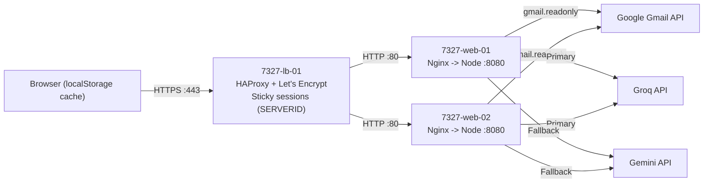

# K-Bail-

A privacy-first Gmail reader that turns long emails into 1–3 bullet summaries, with a full-read view when you need the original message.

Live at **https://kbail.kingsleykoech.tech** (includes a **Sample Mail** mode if you want to try it without signing in with Google).

---

## How it works



- **No server database:** Emails and summaries are never written to disk on the server. Sessions stay in RAM (`express-session`) and fetched mail is cached in your browser's `localStorage`.
- **Read-only access:** Uses Google OAuth 2.0 with `gmail.readonly` and `userinfo.email` scopes only.
- **Fast summaries with fallback:** Summarizes via Groq first and falls back to Gemini if Groq fails or hits rate limits.
- **Clean URLs:** `/` serves the login page and `/inbox` serves the 3-pane workspace (Inbox, Summarize, Full Mail), redirecting unauthenticated requests back to `/`.

---

## Running it locally

```bash
git clone https://github.com/kingsleykipkoech/K-Bail-.git
cd K-Bail-/BACKENDS
npm install
```

Create `BACKENDS/.env`:

```env
PORT=8080
HOST=127.0.0.1
SESSION_SECRET=replace-with-a-random-secret

GOOGLE_CLIENT_ID=your-google-client-id
GOOGLE_CLIENT_SECRET=your-google-client-secret
GOOGLE_REDIRECT_URI=http://localhost:8080/auth/google/callback

GROQ_API_KEY=your-groq-api-key
GEMINI_API_KEY=your-gemini-api-key

GMAIL_MAX_RESULTS=100
MAX_SUMMARIZE_PER_SYNC=5
```

Start the server:

```bash
npm start
```

Open `http://localhost:8080` in your browser.

---

## API & routes

| Route | Purpose |
| :--- | :--- |
| `GET /` | Landing / login page |
| `GET /inbox` | 3-pane inbox UI (requires active session) |
| `GET /auth/google` | Starts Google OAuth 2.0 sign-in |
| `GET /auth/google/callback` | Completes OAuth and redirects to `/inbox` |
| `GET /auth/sample` | Starts a demo session with sample emails |
| `GET /auth/logout` | Clears session and returns to `/` |
| `GET /api/health` | Health check |
| `GET /api/me` | Current session mode and email |
| `GET /api/emails` | Fetches emails and AI summaries |
| `POST /api/sync` | Re-syncs inbox and summarizes new mail |
| `GET /api/emails/:id/full` | Loads the full body of a single email |

---

## Project layout

```text
K-Bail-/
├── assets/clouds.mp4              # Background video
├── BACKENDS/
│   ├── package.json
│   ├── sample_emails.json         # Demo dataset for Sample Mail mode
│   └── server.js                  # Express server, OAuth, Gmail sync, Groq/Gemini
└── UIUX/
    ├── html/
    │   ├── landing.html           # Login page (/)
    │   └── home_page.html         # Inbox workspace (/inbox)
    ├── scripts/home_page.js       # Client state, search/filter/sort, localStorage
    └── styles/                    # base.css, landing.css, home_page.css
```

---

## Production deployment

- **Load balancer (`7327-lb-01`):** HAProxy terminates TLS using a Let's Encrypt certificate for `kbail.kingsleykoech.tech`, redirects HTTP to HTTPS, and pins sessions to `web01` / `web02` using `SERVERID` cookies.
- **Web nodes (`7327-web-01`, `7327-web-02`):** Nginx proxies `kbail.kingsleykoech.tech` to Node.js (`kbail.service` via `systemd`) on `127.0.0.1:8080`.

---

Built by Kingsley Kipkoech
